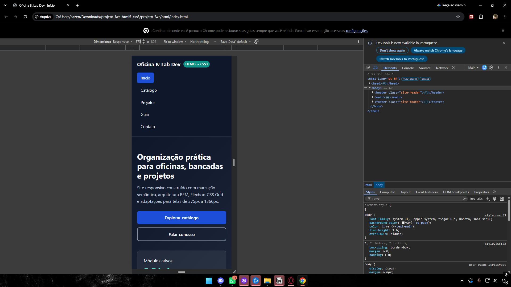
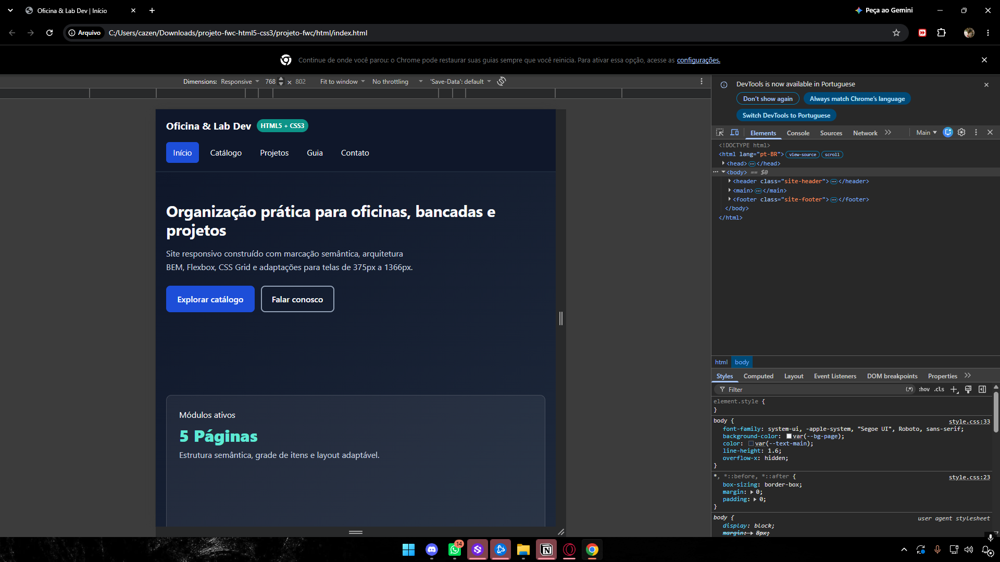
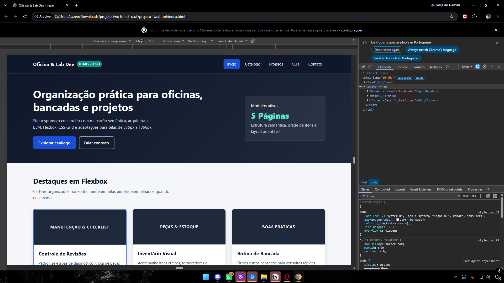

# Oficina & Lab Dev — Projeto Final (Web Coding)

Site responsivo desenvolvido com **HTML5** e **CSS3** para a disciplina de Programação — Web Coding (Ciência da Computação).

## 1. Estrutura de pastas

- `html/`: `index.html`, `catalogo.html`, `projetos.html`, `guia.html` e `contato.html` (5 páginas HTML semânticas interligadas com menu de navegação funcional em todas).
- `css/style.css`: folha de estilo externa com identidade visual consistente, variáveis, estados `:hover` e `:focus-visible`, BEM, Flexbox, CSS Grid e Media Queries.
- `images/`: capturas de tela do site nos diferentes tamanhos exigidos (`print-375px.png`, `print-768px.png` e `print-1366px.png`).

## 2. Onde cada requisito foi aplicado

### Metodologia BEM
- **Block:** `.card`, `.nav-menu`, `.site-header`, `.hero`, `.btn`, `.form-box`
- **Element (`__`):** `.card__media`, `.card__conteudo`, `.card__titulo`, `.card__descricao`, `.card__botao`, `.nav-menu__link`, `.site-header__inner`
- **Modifier (`--`):** `.card--destaque`, `.nav-menu__link--active`, `.btn--primary`, `.btn--outline`, `.btn--sm`, `.section--alt`

### Flexbox (3 áreas distintas)
1. **Cabeçalho e navegação:** `.site-header__inner` e `.nav-menu` (`display: flex`, `flex-direction`, `justify-content`, `align-items`, `flex-wrap`, `gap`).
2. **Lista de cartões:** `.card-flex-row` nas páginas `index.html` e `guia.html`.
3. **Seção Hero e ações:** `.hero__inner`, `.hero__content` e `.hero__actions` em `index.html`.

### CSS Grid Layout (2 áreas distintas)
1. **Grade com 6 cartões (`catalogo.html`):** `.catalog-grid` utilizando `display: grid`, `grid-template-columns: repeat(auto-fit, minmax(260px, 1fr))` e `gap`.
2. **Layout com áreas nomeadas (`projetos.html`):** `.dashboard-grid` utilizando `display: grid`, `grid-template-columns`, `grid-template-areas` (`main`, `aside`, `footer-note`) e `gap`.

### Responsividade e Media Queries
- Blocos `@media screen` em `css/style.css` cobrindo até `768px`, até `480px` e acima de `1024px` (`min-width: 1025px`), ajustando navegação, direções do Flex, colunas/áreas do Grid e botões sem rolagem horizontal indevida.
- Testado nas larguras de **375px**, **768px** e **1366px**.

## 3. Capturas de tela

### 375px (Smartphone)

### 768px (Tablet)

### 1366px (Desktop)

## 4. Recursos extras
- Sem conexão com banco de dados ou API externa neste projeto.
